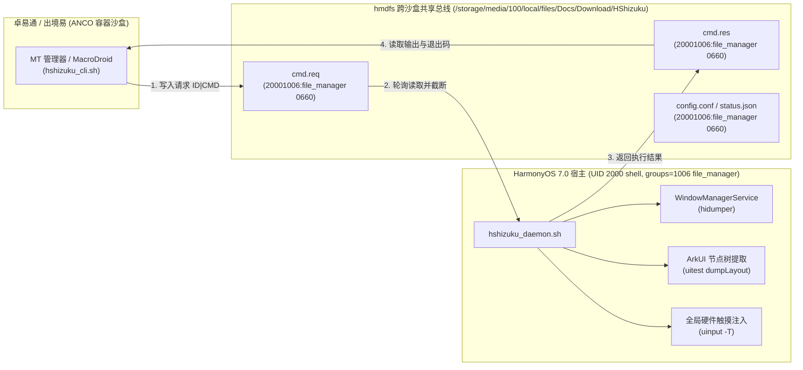

# HMArkPriv 架构设计与跨沙盒通信原理 (`ARCHITECTURE.md`)

## 1. HarmonyOS 7.0 (`HongMeng Kernel 1.13.0`) 安全机制剖析

在 HUAWEI Pura 70 Pro+ (`HBN-AL80 7.0.0.109`) 上的实机逆向与测试表明，HarmonyOS 7.0 相比 Android 乃至 HarmonyOS 4.x 引入了三道极其严密的安全防线：

### 1.1 XPM (Executable Permission Manager) 与 SELinux 执行白名单
- 在传统 Android (Shizuku / Brevent) 中，可以将编译好的 C/C++ ELF 二进制或 `.dex` 推送到 `/data/local/tmp/`，`chmod 755` 后直接运行。
- 在 HarmonyOS 7.0 中，`/data/local/tmp` 虽然没有挂载 `noexec`，但 **HongMeng Kernel 1.13.0 的 XPM 模块与 `u:r:sh:s0` SELinux 策略强行拦截了对 `/data` 分区下任何未签名二进制文件的 `execve()` 系统调用**（即使将 `/system/bin/sh` 复制到 `/data/local/tmp` 或 `/data/local/tmp/debugserver`、`kingkongDir` 下也会返回 `Permission denied`）。
- **突破方案**：**「白名单原生二进制编排架构」**。守护进程本身采用纯 POSIX/Toybox Shell 脚本编写，由只读分区 `/system/bin/sh` 解释执行，所有底层特权能力全部通过调度 `/system/bin/` 下带华为官方系统签名的原生工具完成（如 `hidumper`、`uitest`、`uinput`、`aa`、`bm`、`power-shell`、`svc`）。

### 1.2 `u:r:sh:s0` 网络 Socket `listen()` 与命名管道限制
- 在 `hdc shell` (`u:r:sh:s0`) 上下文中，内核 SELinux 策略禁止进程调用 `listen()` 绑定本地 TCP 端口（返回 `EACCES, errno=13`），也禁止在文件系统创建 `fifo_file` (`mkfifo`)。
- 因此，传统基于本地 Loopback TCP 端口转发的 RPC 通道在无自定义 `.hap` 签名的条件下无法直接建立。

### 1.3 卓易通 (`com.droi.tong`) 与出境易 (`com.easy.hmos.abroad`) 的双层沙盒隔离
- 卓易通与出境易并非运行在鸿蒙宿主进程空间，而是运行在由 `rgm_hmos` / `isulad` 管理的轻量级容器虚拟机（ANCO 架构）中。
- 容器内部拥有独立的网络命名空间与进程树（容器内 `ps` 看不到鸿蒙宿主进程，容器内 `localhost` 也不与鸿蒙宿主回环网卡互通）。

---

## 2. 核心突破：`hmdfs` 跨沙盒共享文件 IPC 总线

通过对 `hdc shell` 与 `hdcd` 权限上下文及挂载表的深度交叉比对，我们发现了一个关键的跨沙盒通道：



### 为什么 `u:r:sh:s0` 能够读写 `Download/HShizuku`？
1. `hdc shell` 进程的凭证为：
   `uid=2000(shell) gid=2000(shell) groups=2000(shell),1006(file_manager),1007(log),1097(netsys_socket),3009(readproc) context=u:r:sh:s0`
2. 虽然 SELinux 禁止 `u:r:sh:s0` 在 `/storage/media/100/local/files/Docs/Download` (`u:object_r:hmdfs:s0`) 下执行 `mkdir` 或 `O_CREAT` 创建新文件，但 **`hdc file send` 运行在更高权限的 `u:r:hdcd:s0` 域下，允许在 `Download/HShizuku` 中创建目录和预分配文件**！
3. 由 `hdc file send` 预创建的文件，其属组恰好是 `1006 (file_manager)`，权限为 `-rw-rw----` (`0660`)。
4. 因为 `u:r:sh:s0` 天然隶属于附加组 `1006 (file_manager)`，所以后台守护进程 `hshizuku_daemon.sh` 对这些预分配文件拥有完整的 **`O_RDWR | O_TRUNC` 读写与覆写权限**！
5. 同时，该目录通过 `hmdfs` 自动映射进卓易通/出境易容器的 `/sdcard/MyHarmonyOSDevice/Download/HShizuku/`，从而实现了**鸿蒙宿主 ⇄ 鸿蒙原生文件管理 ⇄ 卓易通 Android 容器**的三方零延迟共享通信。

---

## 3. 原生「鸿蒙版李跳跳」跳广告引擎设计

由于 HarmonyOS 7.0 限制了第三方无障碍服务，H-Shizuku 采用了一条纯原生的两阶段高速检测流水线：

### 阶段一：亚毫秒级焦点窗口嗅探 (`WindowManagerService`)
守护进程每 `650ms` 调用一次：
```sh
hidumper -s WindowManagerService -a -a
```
- 耗时仅 **`6~8ms`**，CPU 占用低于 `0.2%`。
- 从输出中提取 `Focus window: <WinId>` 以及窗口列表中对应的窗口名称（如 `SCBDesktop`、`wechat0`、`mqq0` 等）。
- **智能白名单与新窗口锁**：
  - 当焦点窗口为桌面 (`SCBDesktop`)、锁屏 (`SCBScreenLock`)、状态栏/控制中心或系统设置时，**直接跳过检测，绝不调用重型 UI Dump**。
  - 仅当检测到**第三方应用新窗口打开的前 `4.5 秒`（开屏广告黄金窗口期）**时，才触发阶段二。

### 阶段二：定向窗口 ArkUI 布局树提取与坐标点击 (`uitest` + `uinput`)
当进入新应用开屏窗口期时，守护进程执行：
```sh
uitest dumpLayout -w <FocusWinId> -p /data/local/tmp/hshizuku/focus_layout.json
```
- 使用 `-w <FocusWinId>` 仅导出当前焦点窗口的 ArkUI 控件树，避免全屏多窗口遍历。
- 使用正则快速检索包含 `跳过` / `跳过广告` 的节点及其 `"bounds":"[left,top][right,bottom]"`。
- **防误触几何校验**：
  - 校验按钮宽度 `30px <= width <= 460px` 且高度 `20px <= height <= 200px`（排除包含“跳过”字样的整屏正文或长列表项）。
  - 校验按钮中心点不在屏幕最左侧边缘，符合右上角/右下角/顶栏开屏跳过按钮特征。
- **硬件级点击注入**：
  计算中心坐标 `(cx, cy)` 后调用 `/system/bin/uinput -T -c <cx> <cy>` 完成点击，并在 `adskip.log` 中记录日志，同时锁定当前窗口防止重复连点。
